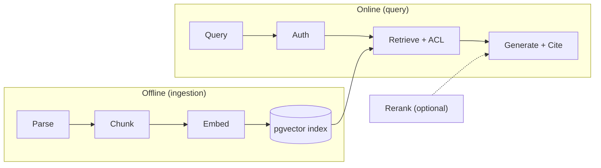

# rag-control-cite

A multi-tenant document Q&A service that answers questions over a permissioned corpus of
public regulatory frameworks, cites the exact spans it used, and returns nothing the caller
is not entitled to — enforced in the retrieval legs, on the fused result set, and inside the
reranker interface. There is no cache; a semantic cache is listed as future work, and the
enforcement rule it would have to satisfy is written down (see *Security model*).

**Status: all 8 stages implemented (2026-10-15/16); Stages 0-6 measured 2026-10-16 on the
rebuilt 235-query test set, and Stage 7 awaits a redeploy to re-measure.** Stage 7 is
implemented and was exercised during development, but its run artifacts were not retained, so
no deployment number is claimed below:

- Ingestion: 2,115 chunks, 0 parse failures, 100% char-sanity.
- Retrieval: dense recall@10 **69.39%** (95% CI 63.97–74.83); hybrid **81.54%**
  (CI 77.22–85.62) → **+12.15 pp**. A weight sweep moves recall (80.19–83.99%), so the
  weighting is not degenerate.
- Rerank: nDCG@5 **77.64% → 69.53%** on equal top-50→5 pools — the cross-encoder *hurts*
  here (−8.11 pp for ~+436 ms p95), so it is **off by default**.
- ACL: **0 leaked of 4,867 chunk checks** across 2,820 (leg × tenant × query) combos; 37,433
  unauthorized candidates prevented. The audit is oracle-checked and mutation-tested.
- Eval gate: **PASS** on 235 evaluated queries — recall@10 83.21% (CI lower 79.18), nDCG@5
  77.64% (CI lower 73.57), groundedness 95.32% (CI lower 92.34); 18 failures, 0 regressions.
- Observability: 100% of the traced demo query was trace-complete.

Numbers live in `RESULTS.md`, generated from the run artifacts in `results/*.json` by
`uv run python scripts/render_results.py --write` — a row without a stored file is not a row.

**Those run artifacts are local and are not published here** (`results/` is gitignored, since it
holds per-run corpus and tenant fixtures). Every row's JSON exists on the author's machine and
is available on request. Without it, read the tables below as *reported*, not as independently
reproducible from this repository alone — which is the standard they were built to, and the
reason the rendering script is published even though its inputs are not.
Everything below is either enforced by code and tested by an oracle independent of the code
under test, or reworded to what is actually built.

## Pipeline



Each stage emits a real OTEL span (`configure_otel`) and records into a bounded,
lock-protected `TraceRecorder`. ACL is fail-closed and is applied when candidates are
gathered (so a small-entitlement tenant is ranked inside its entitled set, not filtered out
after top-k), again after fusion, and inside the reranker (the tenant is a required
argument, so no caller can rerank an unfiltered set).

## Stages

| # | Stage | Ends in |
|---|---|---|
| 0 | Ingestion: parse → chunk → metadata | parse-failure rate, table-extraction rate, char-sanity pass % |
| 1 | Naive baseline (embed → top-k) | recall@10 with a bootstrap 95% CI, p50/p95, $/1k |
| 2 | Hybrid (dense + BM25, RRF) | Δ recall@10 on the exact-term query set, weight sweep |
| 3 | Retrieve-then-rerank (top-50 → top-5) | Δ nDCG@5, added p95 ms |
| 4 | ACL enforcement (retrieval, fusion, reranker) | 0 of N chunk checks leaked, with planted-leak controls |
| 5 | Eval gate (RAG triad + regression) | gate result, failures vs regressions, false-block rate |
| 6 | Observability — OTEL span per stage | % queries trace-complete; latency/cost by stage |
| 7 | Deploy + teardown | cold start, p95 under load, $/1k, teardown verified |

## Corpus

OSCAL machine-readable catalogs from `usnistgov/oscal-content` — **NIST SP 800-53 rev5**
(with the Low/Moderate/High and privacy baseline profiles), **SP 800-171 rev3**, and
**CSF v2.0**. Public domain. These three are what `_CATALOGS` ingests; FedRAMP Rev5, the
real-PDF slice (HIPAA/CMMC/PCI), and the finance framework (FFIEC/SEC/PCI) are *staged, not
wired* — the README says so rather than implying otherwise.

**Synthetic tenants are invented** — the access-control dimensions (framework, control
family, baseline tier, audience) are real, but the tenant assignments are synthetic.

## Security model

- **Tenant is derived from a bearer token, not the request body.** `/query` requires
  `Authorization: Bearer <token>`; the token names the tenant, and a body `tenant_id` that
  disagrees is rejected with 403. When no tokens are configured the service runs
  unauthenticated — local runs only.
- Tokens are **static demo credentials** (`RCC_TENANT_TOKENS`), not an identity-provider
  integration. `/observability` requires an operator token (`RCC_OPERATOR_TOKEN`).
- **ACL is fail-closed.** A chunk missing a tag for a restricted dimension — including a
  zero-tag chunk — is denied unless the tenant holds that dimension as an explicit wildcard.
  Chunks in no baseline carry `baseline:none` and are visible only to a tenant granted the
  baseline wildcard.
- The audit is checked by an **oracle independent of the code under test**: entitlement is
  computed from the raw OSCAL catalogs and baseline profiles, never from `access_tags`.
  Planted-leak controls and a mutation test (patching `can_access` to always-`True` must make
  the audit report leaks) prove the check can fail.
- **Secrets never enter a template.** `deploy.sh` creates the OpenRouter key and the tenant
  tokens out of band in Secrets Manager; the CDK stack references them by name. There is no
  `unsafe_plain_text` anywhere; a synth test fails if a template contains a key-shaped
  string. `.gitignore` covers `cdk.out/`, `cdk-outputs.json`, `.task_ip`, `.cluster`,
  `.service`, `.judge_cache/`. The pre-commit scan is
  `grep -rIlE "sk-or-v1-[A-Za-z0-9]{20,}"`.

## Running

Requires [`uv`](https://docs.astral.sh/uv/), Python ≥ 3.14, and `OPENROUTER_API_KEY`
(embeddings + generation — one key, one provider). Reranking runs locally via
`sentence-transformers`. No keys live in this repository.

```bash
just sync          # install dependencies
just up            # postgres + pgvector
just seed          # ingest → embed → upsert into pgvector
just ingest        # Stage 0 only: parse → chunk → measure
just demo          # Stages 1-4: dense vs hybrid vs rerank, ACL audit
just eval          # Stage 5: eval gate (RAG triad + regression)
just accept        # promote a passing candidate baseline
just deploy        # Stage 7: build image, cdk deploy, resolve task IP
just load <ip> --rps 2 --duration 120   # Stage 7: load test (all four tenants)
just down          # tear down local + AWS — cents, not data
just test          # pytest (offline)
```

CI: `.github/workflows/ci.yml` runs lint + the offline test suite on every push. The
end-to-end eval gate (generation + judge, which cost API calls) runs in
`.github/workflows/eval-gate.yml` on demand and weekly with a stored secret. A failing
gate exits non-zero, leaves `eval/baseline.json` untouched, and uploads the candidate
from `results/eval_candidate.json` — promote it deliberately with `just accept`.

## What broke and how I found it

**Stage 0:** OSCAL JSON parsed clean — 0 parse failures across 3 catalogs. 56.97% of controls
carry structured params; char-sanity: every chunk verifies `chunk.text == source[start:end]`.
The corpus is OSCAL, not PDF — the PDF/HIPAA/CMMC/PCI slice is staged but not wired, and the
~80% ingestion-failure rate applies to that slice, which this repo has not measured.

**Stage 1-3:** dense retrieval misses ~30% of exact control-ID queries; a custom control-ID
tokenizer lets BM25 pull control-ID chunks into the top-k and hybrid gains +12.15 pp recall@10.
On equal pools the cross-encoder *lowers* nDCG@5 by 8.11 pp — it reorders within the right
top-50 but cannot find uncaptured gold, and it is not worth ~+436 ms p95. The earlier
"2x/3x collapses to dense" result was arithmetic (at `k_leg=10`, BM25-only candidates cannot
enter the top 10); at `k_leg=50` the weight sweep moves recall across 80.19–83.99%. Figures
and CIs are in `RESULTS.md`, regenerated from the artifacts.

**Stage 4:** enforcement now runs before, during, and after fusion, and the audit measures
chunk-unit leakage over real retrievals with an independent oracle. The original
"0 unauthorized chunks across 5 probes" was measured by the function under test (the probe
still reported 0 leaks with `can_access` patched to always-`True`); that is gone.

**Stage 5:** the gate never overwrites the baseline on a failing run — it writes a candidate
that is promoted only with `just accept`; it compares a bootstrap CI lower bound to the
threshold, not a point estimate; a *failure* (below a per-query floor) is distinct from a
*regression* (passed in the baseline, fails now); the reported count is the count evaluated.

**Stage 6:** per-stage cost comes from one price table (`pricing.py`) keyed by model id —
an unknown model is a hard error, never a guessed constant. The judge runs a different model
from the generator (no model grades its own output).

**Stage 7:** the stack is tagged `project=rag-control-cite`; `just down` always runs
`scripts/teardown.sh`, which verifies zero resources remain via
`scripts/verify_teardown.sh`. The Dockerfile installs from the lockfile in a real dependency
layer, runs non-root, and health-checks `/healthz`. The store uses a connection pool.

## Results

See `RESULTS.md` — the number, the exact command, and the date, generated from `results/`.

## Non-goals

No GraphRAG, no agent swarm, no multimodal — until a measured failure forces the rung. No
new evaluation framework: the gate is a local, tested implementation (the sibling
`rag-eval-project` is under its own audit; re-adoption as a pinned dependency is deferred).
Not a chat UI. Not a document as the product. No cache and no identity provider yet.

## License

No `LICENSE` file included — all rights reserved. OSCAL content is public domain.
Non-US sources (EBA, BaFin) need a licence check before redistribution. Decide this before
the repository goes public.
